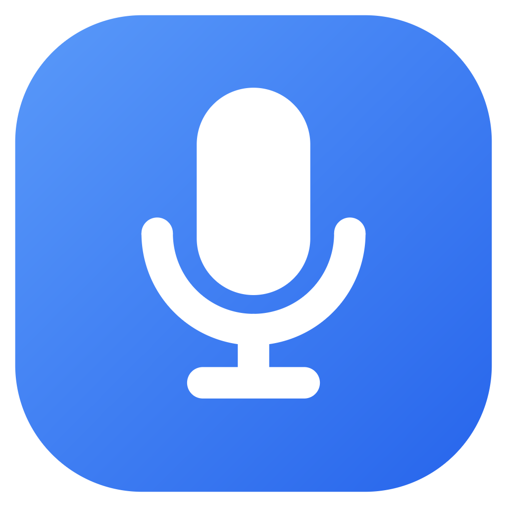

<p align="center">
  
</p>

<h1 align="center">SpeechToText</h1>

<p align="center">
  Голосовой ввод для Windows: нажали клавишу, сказали — в поле появился чистый текст.<br>
  Без «э-э», «ну короче» и оговорок. Плюс звук компьютера в текст, перевод голосом и Stream Deck.
</p>

<p align="center">
  
</p>

<p align="center">
  Windows 10 / 11 · ключ OpenAI API · Stream Deck 6.6+ — по желанию
</p>

## Что умеет

| Функция | Как работает |
|---|---|
| 🎙 **Диктовка** | Курсор в любом поле (Telegram, браузер, Word) → сочетание клавиш → говорите → текст вставляется сам. Режимы «нажать — нажать» и «удерживать». |
| ✨ **Чистка текста** | Убирает слова-паразиты, запинки, повторы и самоисправления («в три, нет, в четыре» → «в четыре»), ставит пунктуацию. Стили: чистка, редактура, деловой, свои правила. |
| 🔊 **Звук ПК → текст** | Записывает то, что играет в колонках или наушниках — созвон, видео, голосовое — и открывает текст в окне поверх всех окон. Можно сразу перевести. |
| 🌐 **Перевод голосом** | Бинды вида «RU → EN» или «Любой → ES»: говорите на одном языке — вставляется на другом. Испанский — в варианте Испании. |
| 🎛 **Stream Deck** | Кнопки диктовки, звука ПК, перевода и отмены. Во время записи горят красным с таймером, закрытое приложение запускают сами. |
| 🕘 **История** | Последние 50 записей с исходником и итогом, минуты и расходы за месяц. |

## Быстрый старт

1. Соберите `SpeechToText.exe` ([ниже](#сборка)) и запустите. Права администратора не нужны.
2. Раздел **API** → вставьте ключ OpenAI → «Сохранить». Приложение проверит его сразу.
3. Поставьте курсор в поле ввода, нажмите **Ctrl + Shift + Space**, скажите фразу, нажмите ещё раз.

**Esc** во время записи — отмена. Сочетания клавиш, микрофон, стиль текста и способ вставки настраиваются в соответствующих разделах. Плагин Stream Deck: **Настройки → Stream Deck → Установить**.

## Модели и цена

| Задача | Модель | Цена |
|---|---|---|
| Распознавание речи | `gpt-live-transcribe` — звук уходит во время речи, текст готов сразу после | $0.017 за минуту |
| Чистка и перевод | `gpt-6-luna` по умолчанию, можно выбрать другую | ≈ $0.0001 за сообщение |

Итого минута диктовки — около двух центов. Фактические расходы видны в разделе «История».

## Безопасность

- **API-ключ** и прокси хранятся зашифрованными через Windows DPAPI: расшифровать их можно только под вашей учётной записью на этом компьютере. В интерфейс ключ не возвращается.
- **История** лежит только локально, в `%APPDATA%\SpeechToText\history.dat`, тоже в зашифрованном виде. Её можно отключить.
- **Звук и текст** уходят только в OpenAI. Вставляемый текст не попадает в журнал буфера Win+V, а буфер обмена после вставки возвращается к прежнему содержимому.
- **Локальный API** для Stream Deck слушает только `127.0.0.1` и принимает запросы с токеном, который меняется при каждом запуске. Запросы из браузера отклоняются.

## Командная строка

```
SpeechToText.exe --toggle dictate
SpeechToText.exe --toggle listen --to ru
SpeechToText.exe --toggle translate --from ru --to en [--source system] [--output clipboard]
SpeechToText.exe --stop | --cancel | --hidden
```

Если приложение уже запущено, команда передаётся ему. Удобно для ярлыков, AutoHotkey и действия «Открыть» в Stream Deck.

## Сборка

Нужны Go 1.26+, [Wails](https://wails.io) CLI v2.17 и Node.js 20+ (только для плагина Stream Deck).

```powershell
go install github.com/wailsapp/wails/v2/cmd/wails@v2.17.0

# Плагин Stream Deck встраивается в exe. Без этого шага приложение тоже соберётся,
# только кнопка установки плагина будет неактивна.
cd streamdeck; npm ci; npm run build; cd ..

wails build -skipbindings -trimpath -ldflags "-s -w -X main.version=1.2.1"
# → build\bin\SpeechToText.exe
```

Тесты:

```powershell
go test ./...                       # хоткеи, Realtime-протокол, чистка и перевод, DPAPI, локальный API
go test -tags live -run Live -v .   # настоящие эндпоинты OpenAI, микрофоны, захват звука ПК
cd streamdeck; npm test             # плагин против имитации Stream Deck
```

## Устройство

| Где | Что |
|---|---|
| `*.go` | Приложение: глобальные хоткеи (low-level hook), микрофон (waveIn) и звук ПК (WASAPI loopback) → `gpt-live-transcribe` по WebSocket, чистка и перевод (Responses API), вставка в активное окно, индикатор записи |
| `frontend/dist/` | Интерфейс — Wails, чистый HTML/CSS/JS |
| `streamdeck/` | Плагин Stream Deck на `@elgato/streamdeck` |
| `internal/` | Отрисовка иконок и индикатора без внешних библиотек |
